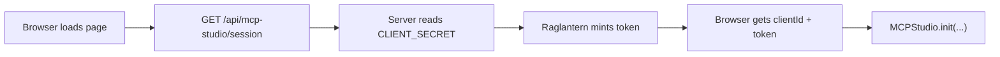

# Raglantern SDK Sample Apps

Working demo apps showing how to embed **Raglantern SDK** in a Next.js product. Each one is a complete, runnable integration you can clone, point at your own credentials, and see live.

These contain no Raglantern internals and no credentials. You supply your own.

## Apps in this repo

| App | Concept | Port |
|-----|---------|------|
| `apps/helpdesk-iq` | Customer support platform where teams build MCP servers from product docs and knowledge bases | 3000 |
| `apps/policy-pilot` | Compliance and legal operations, building MCP servers from policy and regulatory content | 3001 |
| `apps/knowledgecloud-lms` | Enterprise LMS, building course-specific MCP servers for onboarding and training | 3002 |

Ports differ so you can run all three at once and compare configurations.

## Every SDK feature, a different scenario in each app

Each app uses all six features, each in a way that fits its product, so you can compare more than one way to use the same capability.

| Feature | HelpDesk IQ (support) | PolicyPilot (compliance) | KnowledgeCloud LMS (training) |
|---|---|---|---|
| **End-user accounts** (session token) | Switch between three customer companies; each workspace has its own servers, dashboard, and analytics | Switch between framework owners (SOC 2, HIPAA, ISO 27001) | Switch between instructors, one per course |
| **Branding** (`/api/sdk/embed-config`) | Read server-side; the plan sets the per-customer limit and the header names the watermark | Vendor disclosure line in the audit evidence | Browser-side "what instructors see" preview |
| **Portal API keys** + REST | Counts each customer's servers and requests | Provisions an owner's approved-policy server from the backend, with no wizard | Builds the admin's instructor roster |
| **Business Intelligence** | Support manager ranks customers by MCP requests, with a drill-down link per customer | Per-owner audit table (requests, answer rate) and a deep link to that owner | Per-instructor insights link from the roster |
| **Limits** | "Using all of its servers" replaces the wizard at the per-customer ceiling | The REST refusal is shown as Raglantern wrote it, ready for an end user | Course seats per instructor, plus the shared monthly request pool |
| **Headless MCP** + `X-MCP-Studio-End-User` | Escalation lookup runs `list_servers` for one customer | "Restrict" runs `set_server_visibility`, plus a Cursor `mcp.json` snippet | "Retire course" runs `delete_server` with `confirm: true` |

The Business Intelligence links open `https://appatools.com/mcp-studio-sdk/portal/analytics?endUserId=<id>`, which signs you in to the portal and shows that one customer. The full report is portal-only because it needs your developer sign-in.

## Quick start

You need your own credentials. The apps will not render the wizard without them, and the on-screen message tells you exactly what is missing.

**1. Get credentials** from the [Raglantern SDK portal](https://appatools.com/mcp-studio-sdk/portal). You need both the **Client ID** and the **Client Secret**. The secret is shown in full only when you generate it.

**2. Install and configure:**

```bash
npm install
cd apps/helpdesk-iq
cp .env.example .env.local
```

Edit `.env.local` and paste both values:

```bash
MCP_STUDIO_CLIENT_ID=your_client_id_here
MCP_STUDIO_CLIENT_SECRET=your_client_secret_here
```

**3. Run it** from the repo root:

```bash
npm run dev:helpdesk    # http://localhost:3000
npm run dev:policy      # http://localhost:3001
npm run dev:lms         # http://localhost:3002
```

Each app is configured independently, so repeat step 2 in each app directory you want to run.

## Why both credentials are required

Your **Client ID is public**. It ships to the browser in the embed config, so anyone can read it in your page source. That is expected, and it means the ID alone does not prove an embed session came from you.

Your **Client Secret is not public**. Your backend exchanges it for a short-lived attribution token, and only that token goes to the browser. It expires in 15 minutes and can be spent once.

The same exchange sends an `endUserId` and gets back a **session token** for that one user. With it, the wizard deploys the server in place, and the **My servers** and **Analytics** tabs show that user's servers through `MCPStudio.dashboard` and `MCPStudio.analytics`. End users never need a Raglantern account, and their limits come from your SDK plan rather than Raglantern's free tier. See [End-user dashboard](https://docs.appatools.com/sdk/guides/end-user-dashboard).

The samples have no sign-in, so the page lets you pick a demo user and the session route accepts only ids from a fixed list (`src/lib/demo-users.ts`). In your app, take `endUserId` from your own signed-in session, never from the request: whoever controls it acts as that user.

## The optional API key

An integrator API key (`msk_live_...`, created at [Portal → API keys](https://appatools.com/mcp-studio-sdk/portal/api-keys)) lets your backend act for one end user by sending `X-MCP-Studio-End-User: <endUserId>`, over the REST API at `https://appatools.com/mcp-studio/api` or Headless Context MCP at `https://appatools.com/mcp-studio/api/headless/mcp`. Add it as `MCP_STUDIO_API_KEY` to turn on the backend panels in each app. It manages every server your integration owns, so treat it like the client secret. See [API and Headless MCP](https://docs.appatools.com/sdk/guides/api-and-headless-mcp).

These samples demonstrate that full flow rather than the shortest thing that renders, because the shortest thing that renders is an unverified session, and an unverified session cannot bill overage.



## What each sample includes

- Next.js 14 App Router fullstack setup
- One API route with mock business data, so the page has real context around the embed
- `src/lib/mcp-studio.ts` — server-side credential reading, token minting, and REST, Headless MCP, and embed config helpers
- `src/lib/demo-users.ts` — the demo end users, standing in for your signed-in users
- `src/app/api/mcp-studio/session/route.ts` — the session endpoint your integration needs
- Scenario routes that use the API key (see the table above and each app's README)
- `src/components/McpStudioEmbed.tsx` — the browser half, which never sees the secret
- `src/components/SetupNotice.tsx` — actionable setup screen shown until credentials are present
- A README covering the concept, the customizations chosen, and how credentials flow

## Environment variables

| Variable | Required | Reaches the browser |
|----------|----------|---------------------|
| `MCP_STUDIO_CLIENT_ID` | Yes | Yes, it is public |
| `MCP_STUDIO_CLIENT_SECRET` | Yes | **No** |
| `MCP_STUDIO_API_KEY` | No, turns on the backend panels | **No** |
| `MCP_STUDIO_BASE_URL` | No | No |
| `MCP_STUDIO_API_URL` | No | No |
| `NEXT_PUBLIC_MCP_STUDIO_EMBED_URL` | No | Yes |

Do not rename the secret to `NEXT_PUBLIC_MCP_STUDIO_CLIENT_SECRET`. Next.js inlines every `NEXT_PUBLIC_*` value into the JavaScript bundle, which would publish it to every visitor. Raglantern additionally refuses the token exchange when it arrives from a browser, so that mistake fails loudly instead of leaking quietly.

`.env.local` is gitignored. `.env.example` is the tracked template.

## Troubleshooting

| What you see | Cause | Fix |
|---|---|---|
| "Add your Raglantern credentials" | One or both values are missing or still the placeholder | Edit `.env.local`, then restart the dev server |
| "Raglantern rejected these credentials" | The ID and secret do not match a developer account | Copy both again from the portal |
| Setup card persists after editing `.env.local` | Next.js reads env files at startup | Restart the dev server |
| "Add an integrator API key" in a panel | `MCP_STUDIO_API_KEY` is not set | Create a key in the portal, add it to `.env.local`, restart |
| A panel shows `Invalid end user` or 401 | The key is not an SDK portal key, or was revoked | Create a new key at Portal → API keys |
| Port already in use | Another app or process holds it | Stop it, or run `next dev -p <port>` |

## Documentation

- [Embed the widget](https://docs.appatools.com/sdk/getting-started/embed)
- [Verify embed sessions](https://docs.appatools.com/sdk/guides/attribution-tokens)
- [End-user dashboard](https://docs.appatools.com/sdk/guides/end-user-dashboard)
- [API and Headless MCP](https://docs.appatools.com/sdk/guides/api-and-headless-mcp)
- [Branding](https://docs.appatools.com/sdk/guides/branding)
- [Analytics and observability](https://docs.appatools.com/sdk/guides/analytics-and-observability)
- [Configuration reference](https://docs.appatools.com/sdk/reference/configuration)
- [API reference](https://docs.appatools.com/sdk/reference/api)

## Notes

These demos are UI-first and intentionally lightweight. Replace the mock API data and branding with your own to build a tailored demo.

PolicyPilot includes one ready-made policy document, the Harborline Ferries terms of carriage:

https://zthewriter.github.io/harborline-brand/terms-of-carriage.pdf

Its **Provision** button creates a server from it through the REST API, or paste the URL into the embedded wizard.
